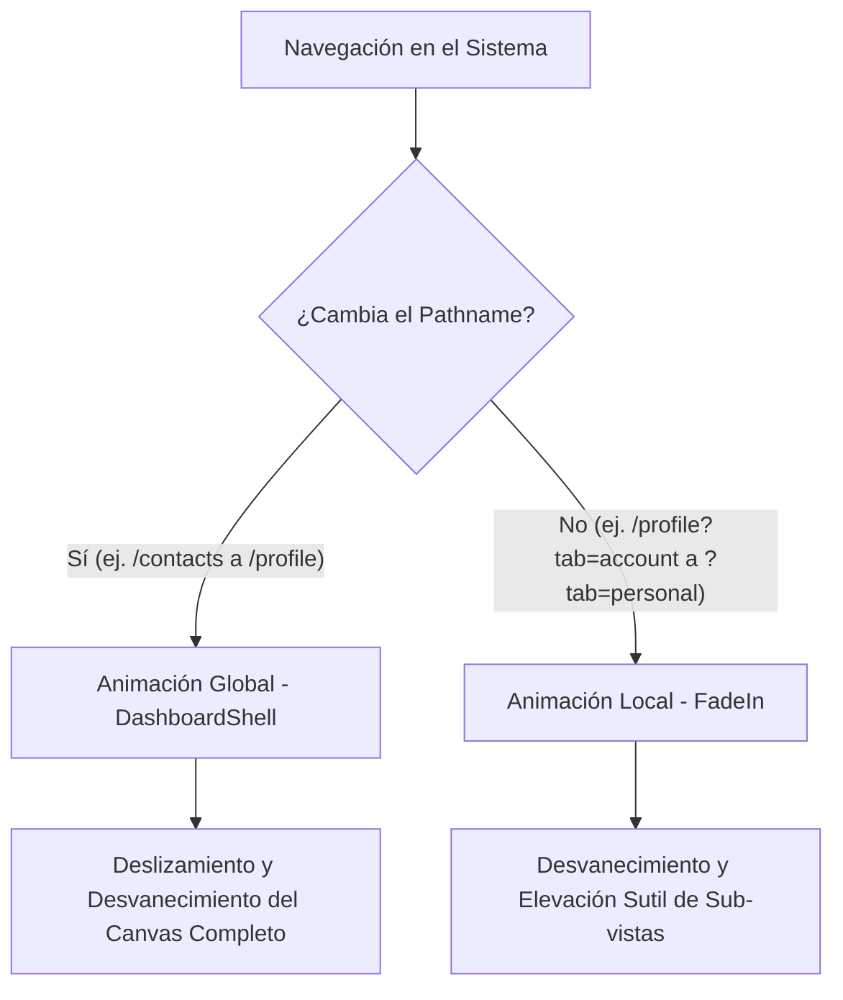

# Contrato de Arquitectura: Animaciones y Transiciones de Vista

Este contrato define las reglas de gobernanza, criterios de uso, especificaciones técnicas y la guía de referencia módulo por módulo para la aplicación de animaciones de entrada locales en todo el ecosistema de **ERPGrafico** (excluyendo vistas del POS).

---

## 1. Declaración de Misiones (Gobernanza Visual)

El sistema visual de ERPGrafico está diseñado para transmitir una sensación **premium, fluida e industrial**. Para lograr esto de forma coherente sin penalizar el rendimiento ni cansar al usuario, dividimos el manejo de transiciones en dos capas estrictas:



### Reglas Invariables (PR Reject si se violan)
1. **Cero imports directos de `framer-motion` en páginas**: Queda prohibido importar `motion` de `framer-motion` para animaciones de entrada de páginas o pestañas secundarias. Debe usarse obligatoriamente el componente compartido `<FadeIn>`.
2. **Cero duplicación de animación en páginas simples**: Las páginas que solo cambian de contenido mediante una ruta única no deben envolverse en ningún componente de animación local. La transición la realiza el [DashboardShell](../../frontend/components/layout/DashboardShell.tsx).
3. **Respeto Absoluto a Accesibilidad (Reduced Motion)**: Toda micro-animación local o global debe integrarse con las configuraciones de accesibilidad del sistema operativo para usuarios con sensibilidad al movimiento vestibular.

### §1.1 Lista de Prohibiciones (ADR-0075)

Se prohíbe, como PR Reject, en componentes de página/módulo:

- `animate-in` / `animate-out` escritos a mano en cualquier archivo fuera de `FadeIn.tsx` / `fade-in-class.ts` (y de `components/ui/`). El test `animate-in.contract.test.ts` lo hace cumplir sin allowlist desde ADR-0157.
- `animationDelay` / `animationFillMode` inline y `@keyframes` propios en contenido de página.
- Imports directos de `framer-motion` (regla 1, reafirmada).

La entrada de contenido se entrega solo vía: (a) transición global del `DashboardShell` al cambiar pathname, (b) `<FadeIn>` para sub-vistas del mismo pathname (delay vía prop `delay`, GPU-only y reduced-motion aware), o (c) la receta `fadeInClass()` para un elemento que no se puede envolver (§2.1).

### §1.2 Module Grids (ADR-0074 + ADR-0075)

Los grids de módulos (Dashboard y Settings) renderizan **tarjetas estáticas sin animación local** — el shell ya anima la vista completa. Cualquier entrada escalonada que se desee se aplica con un **único `<FadeIn>` del consumidor** que envuelve todo el grid, nunca per-card con `animationDelay` inline.

### §1.3 Micro-feedback (ADR-0075 §4)

Las pulsaciones/rebotes de atención (iconos de éxito/éxito-alerta, `animate-bounce`, `scale` de confirmación) están permitidas como **cue breve SOLO si**:

- se acompañan de `motion-reduce:animate-none`, o
- quedan cubiertas por el floor global de SC 2.3.3 (ver §1.4).

### §1.4 Floor Global Reduced Motion (WCAG 2.1 SC 2.3.3)

`frontend/app/globals.css` define el floor global (ADR-0075): bajo `prefers-reduced-motion: reduce`, cualquier elemento que aplique utilidades de entrada (`.animate-in`/`.animate-out`) o `animation-delay` inline colapsa a un único frame (`0.01ms`, sin delay, sin iteraciones extra, `transform: none`). Se mantienen además las reglas específicas de skeleton y sheets (100ms) y los pares `motion-reduce:` más fuertes donde existan (`DashboardShell`).

---

## 2. El Componente Compartido: `<FadeIn>`

El componente [FadeIn.tsx](../../frontend/components/shared/FadeIn.tsx) encapsula la lógica de transición optimizada para hardware, con soporte integrado de accesibilidad.

### Interfaz del Componente (`FadeInProps`)

```typescript
export interface FadeInProps {
    children: React.ReactNode
    className?: string   // Clases de Tailwind adicionales para diseño/grillas
    delay?: number       // Retardo antes de iniciar (en segundos)
    duration?: number    // Duración de la animación (por defecto 0.35s)
    yOffset?: number     // Distancia de elevación vertical (por defecto 8px)
}
```

### Ejemplo de Uso Básico (Pestañas Simples)

```tsx
import { FadeIn } from "@/components/shared"

function SalesTabView({ activeTab }: { activeTab: string }) {
    return (
        <div className="w-full">
            {activeTab === "orders" && (
                <FadeIn>
                    <OrdersTable />
                </FadeIn>
            )}
            
            {activeTab === "invoices" && (
                <FadeIn>
                    <InvoicesTable />
                </FadeIn>
            )}
        </div>
    )
}
```

### Ejemplo de Uso Avanzado (Grid estático — un solo FadeIn)

Per §1.2, un grid estático NO anima cada tarjeta: un único `<FadeIn>` del consumidor envuelve todo el grid.

```tsx
import { FadeIn } from "@/components/shared"

function DashboardWidgets() {
    return (
        <FadeIn>
            <ModuleGrid items={modules} />
        </FadeIn>
    )
}
```

### §2.1 Receta de clases: `fadeInClass()` (ADR-0157)

Cuando el elemento animado no admite un wrapper —un mensaje de error bajo un campo, un chip que aparece, un `TooltipContent`, una clase condicional dentro de `cn()`, un overlay `fixed`— se usa la receta del mismo primitivo sobre su propio `className`. Vive en `components/shared/fade-in-class.ts`, **sin** `"use client"`, para que también la usen Server Components (`not-found`, skeletons de `loading.tsx`).

```tsx
import { fadeInClass } from "@/components/shared"

<p role="alert" className={cn("text-3xs text-destructive", fadeInClass({ from: "top", distance: 1, duration: 200 }))}>…</p>
```

| Opción | Valores | Default |
|---|---|---|
| `from` | `"top" \| "bottom" \| "left" \| "right"` | sin desplazamiento |
| `distance` | `1 \| 2 \| 3 \| 4 \| 8` (escala de spacing, sigue el dial `--k`) | `2` |
| `zoom` | escala desde 95 % | `false` |
| `fade` | opacidad desde 0 | `true` |
| `duration` | `150 … 700` ms | 150 ms (librería) |
| `delay` | `200` ms | — |
| `ease` | `"premium" \| "spring"` | `ease` |

Siempre añade `fill-mode-both` y `motion-reduce:animate-none motion-reduce:opacity-100`. Las clases salen de tablas literales (Tailwind solo genera lo que lee en el código): un valor nuevo se agrega a la tabla, nunca se interpola.

---

## 3. Criterios Técnicos y Optimización de Rendimiento

Para asegurar que las animaciones locales se rendericen a **60-120 FPS** sin causar retardos perceptibles (*jank*), se imponen las siguientes reglas técnicas:

> [!IMPORTANT]
> **Propiedades Permitidas para Animar:**
> Únicamente se permite animar propiedades compuestas por la **GPU**: `opacity` y `transform` (desplazamientos `translateX/Y`, escala). 
> **Queda estrictamente prohibido** animar propiedades como `width`, `height`, `padding`, `margin`, `border` o `font-size`, ya que causan recalculaciones completas del flujo del documento (*CSS Reflow / Layout Thrashing*).

> [!TIP]
> **Transiciones de Salida:**
> En aplicaciones SPA complejas con alta concurrencia de datos, las animaciones de salida (`exit`) intensas bloquean la destrucción inmediata de elementos del DOM por parte de React. El componente `<FadeIn>` utiliza una salida de opacidad rápida y optimizada para asegurar que el DOM se libere al instante.

---

## 4. Estado

La auditoría módulo por módulo de mayo de 2026 quedó obsoleta: desde ADR-0079 los módulos navegan por rutas (`/inventory/products`, `/sales/orders`…), de modo que la entrada de cada vista la anima el `DashboardShell` y `<FadeIn>` queda para sub-vistas del mismo pathname (wizards, pestañas por query param, paneles de POS). En ADR-0157 las 104 animaciones inline restantes (73 archivos) migraron a `fadeInClass()` y el ratchet se cerró en 0.
