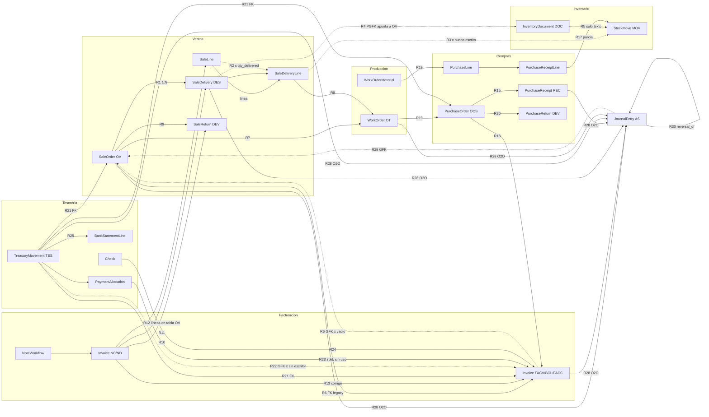

# Grafo documental actual — Fase 2

> Entregable 2b · 2026-10-14 · IDs de arista `R#` = [document-relations-matrix.md](./document-relations-matrix.md).
> Línea continua = FK/O2O íntegra · `-.->` = GFK / PGFK / texto / heurística · `x` en etiqueta = relación rota o no escrita (evidencia C/E/D).

## A. Grafo de tipos documentales

## B. Mapa de implementación (dónde vive cada relación)

| Relación | Define (modelo) | Persiste | Crea (servicio) | Consulta (selector/serializer) | Presenta (UI) | Completitud |
|---|---|---|---|---|---|---|
| OV→Despacho R1 | `sales/models.py:555` | FK | `sales/services.py:177` | `sales/selectors.py:104` | Order Hub `LogisticsPhase.tsx:128` | Alta |
| Cumplimiento línea R2 | `sales/models.py:376` | agregado | `sales/services.py:710` | `_update_order_delivery_status :766` | estado de entrega OV | **Rota** (E, D) |
| Despacho línea→Stock R3 | `sales/models.py:652` | O2O | `sales/services.py:686-703` | `inventory/selectors.py:433`, `billing/selectors.py:99` | StockMoveDrawer, Invoice stock moves | **Rota** (E, D 83/83) |
| Doc. inventario→origen R4/R33 | `inventory/models.py:1452` | PGFK | 11 sitios (`sales/services.py:586`…) | ninguno tipado | `inventoryDocumentFields.tsx` (NV) | Baja |
| Doc. inventario→Stock R5 | — | texto | `inventory/services.py:179` | — | — | **Ausente** |
| OV/OC→Factura R6/R18 | `billing/models.py:82-94` | FK + GFK | `billing/services.py:456,597` | `billing/selectors.py:75-96` | InvoiceDrawer, BillingPhase | Media (GFK muerto, sin líneas) |
| Notas R10-R14 | billing/sales/purchasing | FK + JSON | `billing/note_checkout_service.py` | `billing/selectors.py:93,121` | Hub notas | Media (sin datos para validar) |
| Pago R21-R23 | `treasury/models.py:202-221, 2343` | FK + GFK + tabla | `treasury/orchestrator.py`, `allocation_service.py` | `sales/selectors.py:116`, `billing/serializers.py:82` | PaymentHistoryModal, CashMovementDrawer | **3 vías**, 1 usada |
| Contabilización R28/R29 | abstracto + `accounting/models.py:435` | O2O + GFK | 45 puntos `create_entry` | `JournalEntry.source_info :570` | JournalEntryDrawer `source_documents` | Alta (21 sin origen) |
| Reversión R30 | `accounting/models.py:441` | FK | `accounting/services.py reverse_entry` | — | NV | Alta |
| Auditoría cancel/annul R38 | `workflow/models.py:11` | PGFK | 5 tipos | NV | NV | Parcial |

## C. Cómo se exponen las relaciones (3 contratos incompatibles)

| Endpoint/serializer | Forma | Tipos usados | Evidencia |
|---|---|---|---|
| `SaleOrder.related_documents` | `{invoices[], notes[], payments[], deliveries[]}` con `display_id`, `docType:"sale_delivery"` | ad-hoc snake | `sales/selectors.py:85-132` |
| `Invoice.related_documents` | `[{type, id, name, url}]` | `purchase_order`, `sale_order`, `credit_note`, `debit_note` | `billing/selectors.py:85-96` |
| `StockMove.related_documents` | `[{type, id, name, url}]` mezclando `JournalEntry.source_info` (label `app.model`) con tipos ad-hoc; URLs a listados sin id | mixto | `inventory/selectors.py:826-838` |
| `JournalEntry.source_documents` | `[source_info]` con label `app.model` + `detail_url_pattern` del backend | canónico | `accounting/models.py:570-594` |

`source_info` del asiento es el único formato alineado con `ENTITY_DRAWERS`/`SourceDocumentLink`; es la semilla natural de un contrato común (Fase 4).
