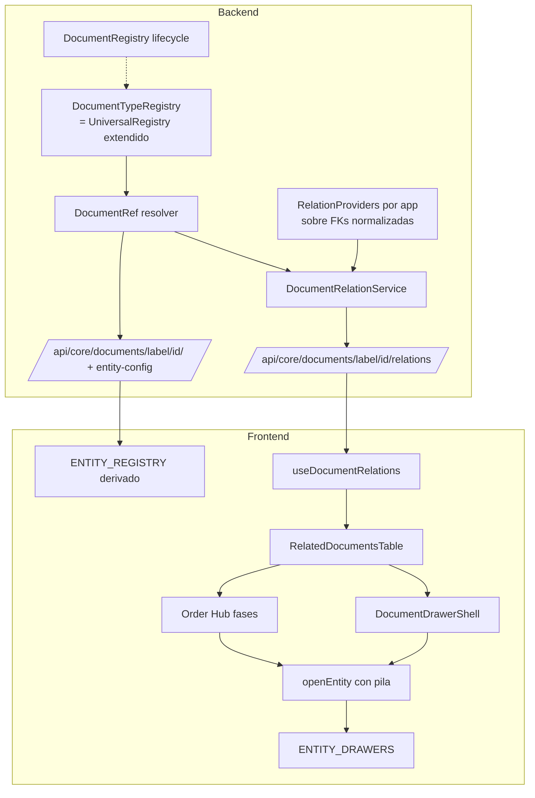

# Arquitectura documental objetivo — Fase 4

> Entregable 4 · 2026-10-14 · Propuesta, **no implementada**. Derivada de las Fases 1-3:
> [inventario](./documents-inventory.md) · [matriz](./document-relations-matrix.md) · [grafo](./document-graph.md) · [integridad](./document-integrity-findings.md) · [navegación](./document-navigation-audit.md).
> (El brief pide `arget-document-architecture.md`; se usa el nombre corregido.)
> Cambia contratos de capa 20 (`entity-identity`, `component-entity-drawers`, `list-modal-edit-pattern`) → requiere **ADR** (siguiente número libre: 0080) antes de implementar (invariante 12).

## 0. Principios derivados de la evidencia

1. **No hay base común que unificar en BD**: 7 de ~25 documentos heredan `TransactionalDocument`; identidad, numeración y estados divergen. Unificar tablas sería una reescritura → descartado.
2. **El problema dominante no es de presentación sino de persistencia**: las relaciones más usadas están rotas o duplicadas (INT-01…06). La capa de navegación no puede ser mejor que los datos que resuelve → **reparar persistencia antes de construir UI sobre ella**.
3. **Ya existen las piezas correctas**, dispersas: `UniversalRegistry` (identidad), `JournalEntry.source_info` (referencia canónica `app.model`), `ENTITY_DRAWERS`+`openEntity`+`SourceDocumentLink` (apertura), `ActivitySidebar` (historial), Order Hub (vista de proceso). La solución es **consolidar**, no inventar.

## 1. Identidad documental común (4.1)

### Opción elegida: **híbrida — modelos específicos + registro de tipos documentales único en backend, servido al frontend**

`DocumentTypeRegistry` = evolución de `UniversalRegistry` (no un registro nuevo). Cada tipo declara:

| Atributo | Universal | Fuente actual |
|---|---|---|
| `label` (`app.model`) | ✔ | `SearchableEntity.label` |
| `title` / `title_plural` / `icon` / `module` | ✔ | `SearchableEntity` |
| `prefix` / `display_id` | ✔ | `EntityPrefix` + propiedad `display_id` (26 modelos; añadir a InventoryDocument, etc.) |
| `list_url` + `canonical_url(id)` | ✔ | hoy repartido en 4 registros (§3 navegación) |
| `status_field`, `date_field`, `partner_field` | ✔ (declarativo) | implícito por modelo |
| `drawer_key` | ✔ | hoy = label en `ENTITY_DRAWERS` |
| `view_permission` | ✔ | `SearchableEntity.permission` (opcional hoy) |
| `relation_provider` | opcional | nuevo (§2) |
| `lifecycle_service` | opcional | `DocumentRegistry` (hoy 2 tipos) |
| campos de dominio (DTE, etapas OT, totales) | ✘ específicos | modelos |

**Contrato `DocumentRef`** (lo único que viaja entre módulos y hacia la UI):

```ts
interface DocumentRef {
  label: string        // 'sales.saledelivery'
  id: number
  display_id: string   // 'DES-000123'
  title: string        // 'Guía de Despacho'
  status: string | null
  status_display: string | null
  date: string | null
  partner_name?: string
  url: string          // canonical_url (lista?selected=id), generado por el registro
  accessible: boolean  // permiso de lectura del usuario
  exists: boolean      // false → referencia no resoluble (GFK/PGFK colgante, borrado)
}
```

Semilla: `JournalEntry.source_info` (`accounting/models.py:570`) ya devuelve `type`(=label), `id`, `display`, `url`.

**Frontend**: `ENTITY_REGISTRY`, `searchableEntityRoutes`, `TYPE_TO_REGISTRY`, `DRAWER_MAP` y los mapas legacy pasan a derivarse del endpoint `/api/core/entity-config/` (ya existe) + `ENTITY_DRAWERS` (solo componente). Labels FE sin modelo (`finance.payment`, `pos.session`, …) se renombran a su `app.model` real con alias temporales.

### Alternativas descartadas

| Alternativa | Motivo |
|---|---|
| Entidad documental centralizada (tabla `Document` padre) | Migración de datos masiva sobre ~25 modelos con FKs PROTECT; sin beneficio para relaciones que ya son FKs |
| Solo capa de navegación FE | No resuelve INT-01…06; seguiría habiendo 3 formatos de relacionados en backend |
| Registro nuevo independiente | Sería el 8º registro; agravaría la dispersión |

## 2. Capa de relaciones (4.2)

### Opción elegida: **servicio de resolución con proveedores por tipo sobre la persistencia existente (normalizada)**; **sin tabla genérica de relaciones** en esta etapa.

Razones: las relaciones de negocio ya son FKs tipadas con `PROTECT`/`SET_NULL` significativos (R1, R7, R15, R21, R28…). Una tabla genérica perdería integridad referencial y duplicaría (ya hay 3 representaciones de pago). El problema es de **escritura rota** y **lectura dispersa**, no de falta de esquema.

```
GET /api/core/documents/{label}/{id}/relations/?semantic=&direction=&limit=
→ { document: DocumentRef,
    relations: DocumentLink[],
    unresolved: [{label, id, reason}] }

interface DocumentLink {
  semantic: 'derivation'|'fulfillment'|'reference'|'settlement'|'posting'|'correction'|'association'
  direction: 'outgoing'|'incoming'
  role: string             // 'delivery', 'invoice', 'payment', 'journal_entry', 'credit_note', ...
  target: DocumentRef
  amount?: number          // p.ej. importe imputado (PaymentAllocation)
  quantity?: number
  line_links?: {source_line_id, target_line_id, quantity}[]   // opcional, bajo demanda
  is_dependency: boolean   // true = derivación/cumplimiento; false = asociación
}
```

- `RelationProvider` por tipo (`sales/relations.py`, `billing/relations.py`, …) — reutiliza los selectores actuales (`SaleOrderSelector.get_related_documents`, `InvoiceSelectorExt.*`, `source_info`) como adaptadores; los formatos viejos se mantienen y se marcan deprecados.
- Permisos: filtra `target.accessible`; no oculta la existencia de la relación (muestra "sin acceso").
- `unresolved`: GFK/PGFK que no resuelven → visibilidad de integridad.
- Relaciones de línea solo donde existen FK de línea (R1, R15, R12); el resto se reporta a nivel documento.

### Normalizaciones de persistencia requeridas (prerequisito)

| Cambio | Hallazgo | Tipo |
|---|---|---|
| Corregir incremento de `quantity_delivered` y emparejamiento línea→StockMove (enlazar por línea, no por clave heurística) | INT-01, INT-02 | lógica + backfill |
| `InventoryDocumentDetail.stock_move` (FK) o `StockMove.inventory_document` (FK) | INT-03 | migración + backfill parcial (vía `description` cuando sea parseable) |
| `InventoryDocument` del despacho/recepción apunta al despacho/recepción (no a la OV) | INT-04 | lógica + backfill desde asiento |
| Pago→documento: fuente única = `PaymentAllocation` (con importe); FK legacy como cache de lectura hasta retirar; eliminar GFK `allocated_to` (sin uso, D 0) | INT-06 | migración + backfill (1 allocation por FK existente) |
| Factura→orden: fuente única = FK tipadas (`sale_order`/`purchase_order`); retirar GFK `source_order` y reescribir sus 4 consumidores | INT-05 | lógica (GFK vacío: sin backfill) |
| Cálculos de pagado/pendiente en un único selector, excluyendo anulados | INT-06 | lógica |

**Diferido** (requiere decisión de negocio): líneas de factura propias (INT-07), separar líneas de notas de las líneas de pedido (INT-08), FK de línea en devoluciones (INT-09).

## 3. Ficha documental común (4.3)

`DocumentDrawerShell` (shared, `components/shared`) — compone piezas existentes:

| Zona | Componente | Reutiliza | Específico |
|---|---|---|---|
| 1 Encabezado | tipo + `display_id` + `StatusBadge` + partner + fecha | `useDrawerIdentity`, `StatusBadge` | — |
| 2 Resumen | slot `summary` | `DataCell`/`*Fields.ts` | por tipo |
| 3 Acciones | slot `actions` filtradas por estado | `useConfirmAction`, `DocumentService` | por tipo |
| 4 Contenido | slot `children` (líneas, etapas…) | `DataTable` | por tipo |
| 5 Relacionados | `RelatedDocumentsTable` (nuevo shared) | `useDocumentRelations` (hook feature) + `EntityBadge` | — |
| 6 Historial | `ActivitySidebar` + eventos de relación/transición | `ActivitySidebar`, `workflow.Transition` | — |
| 7 Contable/logística | pestañas opcionales (asiento, movimientos stock) | relaciones `posting`/`fulfillment` | — |

El **Order Hub se conserva** como vista de proceso para OV/OC/notas (no es una ficha; responde "qué falta hacer"). Debe consumir `relations` en lugar de `related_documents` y abrir documentos vía `openEntity` (eliminar `DRAWER_MAP`).

Debe cumplir invariantes: shared vía barrel, `loading/empty/error`, sin `useQuery` en componentes (invariantes 5, 6, 8), `StatusBadge` único (7).

## 4. Vistas de relaciones (4.4)

| Vista | Usar cuando | Decisión |
|---|---|---|
| **Tabla de relacionados** | Toda ficha; relaciones operativas (≤ ~50) agrupadas por `semantic`/`role`, columnas: rol, documento, estado, fecha, importe/cantidad | **Predeterminada** |
| Línea de tiempo | Historial del documento + transiciones + creación de derivados | En `ActivitySidebar` |
| Flujo de proceso | Ciclo OV/OC/nota con etapas pendientes | Order Hub existente |
| Panel lateral de inspección | Vista rápida de un relacionado sin perder el actual | Pila de drawers (§5) |
| Grafo navegable | Trazabilidad multi-salto real: NC → devolución → stock → asiento, conciliación pago ↔ cartola ↔ facturas | **Diferido**; solo si la tabla no basta tras el piloto |

## 5. Navegación canónica (4.5)

| Aspecto | Propuesta | Compatibilidad |
|---|---|---|
| Ruta canónica | Se mantiene `list_url?selected={id}` (ADR-0020); generada **solo** por el registro backend | 29 patrones rotos se corrigen en el registro; `[id]/page.tsx` siguen redirigiendo |
| Resolución tipo+id | `GET /api/core/documents/{label}/{id}/` → `DocumentRef`; ruta FE genérica opcional `/d/{label}/{id}` que redirige a `canonical_url` (para búsqueda, notificaciones, PDFs, enlaces externos) | aditiva |
| Apertura desde relaciones | Siempre `openEntity(label, id)`; si no hay drawer → `url` | `SourceDocumentLink` ya lo hace |
| Vuelta | `GlobalModalProvider`: `openedEntity` → **pila** (máx. 3-5); "← volver a OV-123" en encabezado | interno al provider |
| Contexto | El drawer abierto desde una relación recibe `via: {label, id, role}` → banner "Abierto desde OV-123 · despacho" | aditivo |
| Anulados / eliminados / sin permiso | `DocumentRef.status`/`exists`/`accessible` → fila atenuada / "eliminado" / "sin acceso"; nunca 404 silencioso | — |
| Búsqueda global | `detail_url` = `canonical_url` del registro; test e2e contra backend real, no mock divergente | `UniversalSearch.tsx` |
| OV/OC `?selected` → Hub | Se conserva (decisión de producto existente) | — |

Consumidores actuales a migrar (C): `openEntity` literal en 6 llamadas; `LazyDrawer` en 8 archivos; `openHub` en 13; `?selected=` en 70 enlaces; `router.push` en 53 archivos (revisar los documentales).

## 6. Diagrama objetivo



## 7. Dependencias respecto del modelo existente

- Requiere completar `display_id` en todos los tipos registrados y registrar en `UniversalRegistry` los que faltan (PurchaseReceipt/Return, SaleDelivery con ruta real, TerminalBatch, F29…).
- Requiere FKs de §2 para que los proveedores no dependan de heurísticas/texto.
- `DocumentRegistry` (lifecycle) puede crecer en paralelo; no es prerequisito de la navegación.
